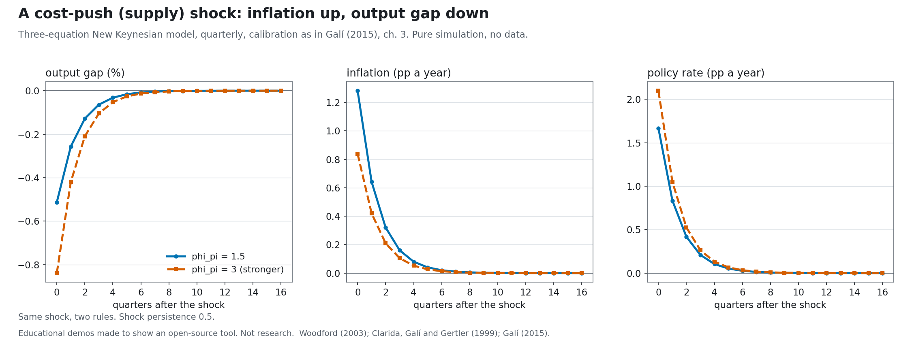
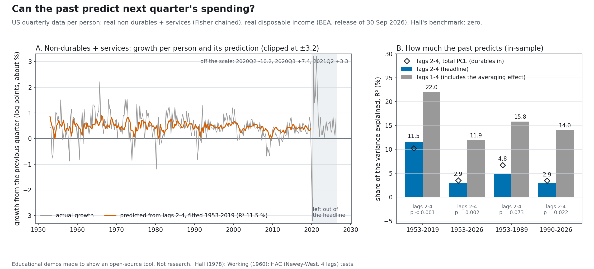

# Economics 2026: the lab with three equations

> **Educational demos made to show an open-source tool. Not research, and not economic or policy advice.**

**Status:** facts: done · claims ledger: done (checked 2026-10-12) · set the rate: done · can you predict spending?: done · independent review of both toys: done, findings fixed · page: done · video: done

On 12 October 2026 the Royal Swedish Academy of Sciences awarded the Sveriges Riksbank Prize in Economic Sciences in Memory of Alfred Nobel 2026 to Robert E. Hall and Michael Woodford, "for microeconomic foundations of macroeconomic stabilisation", half each. (E001, E002, E004) Back to the [front page](../../README.md).

Numbers like (E001) point to rows in [CLAIMS.md](CLAIMS.md), where each sentence has its source. Rows E198 to E228 are our toys' numbers, each equal to a field of the toy's results JSON.

**Our voice stays neutral.** The committee's words appear only as credited quotes. The toys show what a textbook model does and what one test finds in one data set; they are not advice, forecasts or a case for or against any policy, central bank or school of economics. No current events, no named central bank or politician.

## The story in four steps

1. **The question.** Hall asked whether anything can forecast the change in a household's spending. If households look ahead and spend according to what they expect to earn, they change their spending only when news arrives, and news cannot be forecast. (E039, E040) His 1978 paper tested this on US data; the committee says the prediction was "largely borne out", with some departures. (E041, E042, E043, E044)
2. **The exceptions.** With Frederic Mishkin, Hall used food spending by 2,309 US families, 1969 to 1975, and estimated that about 20 per cent of consumption moved one for one with current income ("hand-to-mouth"). (E053, E055)
3. **The older machine, and the new one.** Older models ran on statistical links between big totals, which in the 1970s stopped holding. (E027, E028) Robert Lucas argued for models built on decisions. (E032) Woodford's 2003 book *Interest and Prices* set out a model with three equations: households spend looking ahead, firms set prices looking ahead because changing them is costly, and a central bank follows a rule for the interest rate. (E063, E069 to E072) The committee says it builds on the work of many researchers, and that the two contributions were made independently. (E119, E009)
4. **The limits.** The committee names them itself: the model is mainly about everyday stabilisation, it is hard to prove beyond reasonable doubt that better policy explains quicker recoveries, and promises about rates far ahead have "unreasonably strong effects" in the simple model, with no consensus fix: the forward guidance puzzle. (E147, E145, E115, E116)

## The stations

Four stops, as in a museum. Each says what it is made of and whether it is ready.

<table>
  <tr>
    <td width="96" valign="top"></td>
    <td valign="top"><b>1. Set the rate</b> <i>(ready)</i><br>
    The three-equation model in about 200 lines of NumPy, with the textbook calibration of Galí (2015): a spending burst, a cost shock with a weaker and a stronger rule, the condition on how strongly the rate must answer inflation (1.5 gives one path, 0.8 gives many), and a promise about the rate two years out, with the forward guidance puzzle shown as a caveat. Pure simulation, no data, no forecast. Folder: <a href="set-the-rate/README.md">set-the-rate</a>.</td>
  </tr>
  <tr>
    <td width="96" valign="top"></td>
    <td valign="top"><b>2. Can you predict spending?</b> <i>(ready)</i><br>
    Hall's test on real data: how much of next quarter's change in US spending on non-durables and services, per person, do spending and income two to four quarters back predict, from BEA's public-domain national accounts? 11.5 % from 1953Q1 to 2019Q4, 2.9 % when 2020 to 2026 are included; and the Campbell and Mankiw share of income that goes to households who spend as they earn, which these data estimate only very uncertainly. With a simulated control that has a known answer. Folder: <a href="can-you-predict-spending/README.md">can-you-predict-spending</a>.</td>
  </tr>
  <tr>
    <td width="96" valign="top"></td>
    <td valign="top"><b>3. The interactive page</b> <i>(ready)</i><br>
    Guess first, then see: how much of next quarter's spending change the past predicts, what share of income goes to households who spend as they earn, and three questions about the lab (what a cost shock does, what happens when the rate answers inflation weakly, whether a promise moves inflation today). One file, no network, light and dark. <a href="https://faviovazquez.github.io/nobel-2026-lab/2026/economics/page/">Try it online</a>. Folder: <a href="page/README.md">page</a>.</td>
  </tr>
  <tr>
    <td width="96" valign="top"></td>
    <td valign="top"><b>4. The video</b> <i>(ready)</i><br>
    A 2:48 explainer drawn as a living diagram: Hall's question, the older machine, the three equations wired in a loop, and the lab run four ways. It asks no questions. <a href="video/exports/economics-2026-lab.mp4">Watch the MP4</a>. Every fact in it comes from the <a href="CLAIMS.md">claims ledger</a>. Made with <a href="https://github.com/FavioVazquez/showtime">showtime</a>. Files and how it was made: <a href="video/README.md">video</a>.</td>
  </tr>
</table>

## The pictures

<p align="center">
  <picture>
    <source media="(prefers-color-scheme: dark)" srcset="set-the-rate/results/cost_push_shock_dark.png">
    
  </picture>
</p>

<p align="center">
  <picture>
    <source media="(prefers-color-scheme: dark)" srcset="can-you-predict-spending/results/hall_test_dark.png">
    
  </picture>
</p>

## What is real, and what is ours

| Real | Ours |
|---|---|
| The prize, the laureates, the dates and the papers, from the Academy's press release, popular information and scientific background, and the Nobel API (CC0). The committee's words, quoted and credited. | The model: a textbook three-equation model with an illustrative calibration, not fitted to any economy. Its numbers are the model's answers, not facts about any economy and not forecasts. |
| US national accounts from BEA's public bulk files (release of 30 September 2026, sha256-pinned), used for spending and income per person. | Our regressions on them, written in NumPy and checked against statsmodels and linearmodels in an independent review. They describe one data set; they are not advice and say nothing about why spending moves. |

## Folder map

| Path | What it is | Status |
|---|---|---|
| [FACTS.md](FACTS.md) | The sourced fact sheet: the prize, its history from the Nobel API, the laureates' work as the committee describes it, the limits it states, the data the toys use, and what not to say | done |
| [CLAIMS.md](CLAIMS.md) | The ledger of claims we use, with sources and the check date: the prize and the work (E), the committee lines we quote only as quotes, the toys' numbers with their JSON fields, the film's sentences, and the rows that stop a sentence | done |
| [set-the-rate](set-the-rate/README.md) | Toy 1: the three-equation model | done |
| [can-you-predict-spending](can-you-predict-spending/README.md) | Toy 2: Hall's test and the Campbell and Mankiw share on BEA data, with a simulated control | done |
| [review](review/REVIEW.md) | The independent review of both toys, with its own cross-check code; its findings are fixed in the toys | done |
| [page](page/README.md) | Guess first, then see ([online](https://faviovazquez.github.io/nobel-2026-lab/2026/economics/page/)) | done |
| [video](video/README.md) | A 2:48 explainer ([the MP4](video/exports/economics-2026-lab.mp4)), its poster and captions, the credits, and which claims it uses | done |

## Rerun and check

Everything runs on an ordinary laptop processor in under a minute, with no GPU and no accounts. Each folder's README has its exact steps.

- **Set the rate**, from `2026/economics/set-the-rate/` ([steps](set-the-rate/README.md)):

  ```bash
  python3.11 -m venv .venv && . .venv/bin/activate && pip install -r requirements.txt && python -m nk.run_all
  ```

- **Can you predict spending?**, from `2026/economics/can-you-predict-spending/` ([steps](can-you-predict-spending/README.md)):

  ```bash
  python3.11 -m venv .venv && . .venv/bin/activate && pip install -r requirements.txt && python -m spend.run_all
  ```

- `python -m spend.fetch_data` checks the committed BEA extracts' sha256; `--refresh` downloads the pinned bulk file again (network), without which the raw-file test is skipped.
- **The page** needs nothing: open `2026/economics/page/index.html` in a browser. `python3 -m page.run_all` from `2026/economics/` rebuilds its data from the two toys and refreshes its screenshots ([steps](page/README.md)).
- Tests: `python -m pytest -q` in each toy folder and in `page/`.

These are teaching demos. They show a model's logic and one test on one data set; they do not say what any central bank or government should do.

## Glossary

| Term | In plain English |
|---|---|
| Stabilisation policy | The steps governments and central banks take to even out booms and slumps, such as changing interest rates, taxes or transfers. |
| Output gap | Actual output minus the output the economy would produce if prices were fully flexible. |
| Natural rate | The interest rate that neither speeds nor slows spending; in the model, the rate that would hold if prices were fully flexible. |
| Taylor rule | A rule for the interest rate that raises it when inflation and the output gap rise, named after John Taylor. |
| Forward guidance | Announcing a path for future interest rates. |
| Forward guidance puzzle | In the simple model, promises about rates far in the future have implausibly strong effects today. |
| Hand-to-mouth | Households whose spending tracks their current income. |
| Weak instruments | When the variables used to estimate an effect predict the thing they stand in for only weakly, so the estimate can be far off. |
